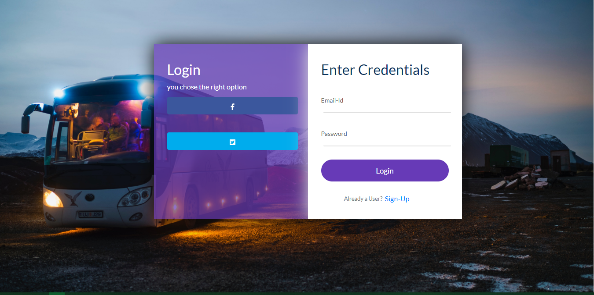
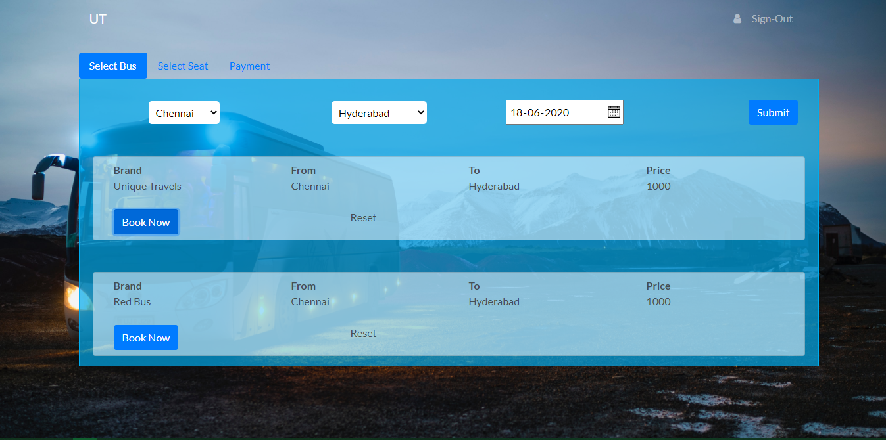
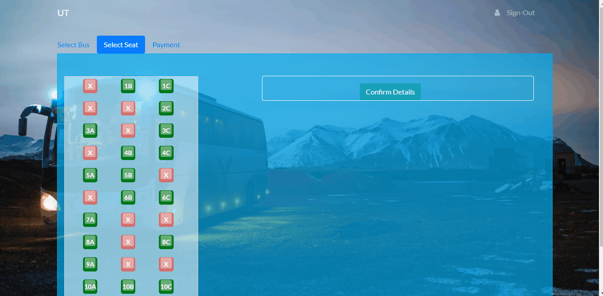
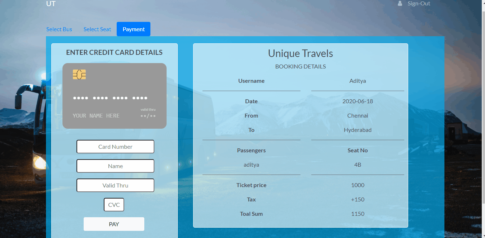

# MERN-BUS-APP-web

Git 仓库：`git@github.com:rick-peng-li/MERN-BUS-APP-web.git`

Unique Travels 长途客车在线订票系统，基于 MERN 技术栈（MongoDB + Express + React + Node.js）实现。用户可以注册登录、查询城市间的班次、在线选座、填写乘客信息、模拟信用卡支付并生成电子车票，同时在个人中心查看账户信息与历史订单。

## 技术架构

| 层 | 技术 |
| --- | --- |
| 前端 | React 16（Create React App）、React Router 5、Bootstrap 4、Axios、react-credit-cards |
| 后端 | Node.js、Express 4、Passport（local + JWT 策略）、jsonwebtoken、bcryptjs |
| 数据库 | MongoDB（Mongoose ODM） |

鉴权方式为 JWT：登录成功后签发 Token，前端将其保存在 `sessionStorage` 中，访问受保护接口时通过 `secret_token` 查询参数（或 `Authorization: Bearer` 头）携带。前后端分离开发模式下通过 `proxy` 将 API 请求转发到后端；生产模式下由 Express 直接托管 React 构建产物。

## 项目结构

```
MERN-BUS-APP-web/
├── backend/                  # Express 后端
│   ├── bin/www               # 服务启动入口（默认端口 8080）
│   ├── app.js                # Express 应用配置与路由挂载
│   ├── auth/auth.js          # Passport 登录策略 + JWT 校验策略
│   ├── config/keys.js        # MongoDB 连接串、JWT 密钥（支持环境变量覆盖）
│   ├── data/buses.json       # 班次种子数据
│   ├── models/               # Mongoose 模型：User / Buses / Booking
│   ├── routes/               # login / register / loggedInUser / routeSelection
│   └── scripts/seed.js       # 数据库初始化脚本（班次 + 演示账号）
├── frontend/                 # React 前端
│   ├── public/
│   └── src/components/       # Homepage / Login-Signup / routeSelector / BusList
│                             # SeatSelection / PaymentTab / TicketPage / Profile / API
└── documentationResources/   # README 展示用截图
```

## 页面与功能

| 路由 | 页面 | 功能 |
| --- | --- | --- |
| `/` | 首页 Homepage | 品牌展示与 Get Started 入口 |
| `/login` | 登录 | 邮箱 + 密码登录，错误提示，签发 JWT |
| `/register` | 注册 | 姓名/邮箱/手机号/性别/生日/密码注册，重复邮箱拦截 |
| `/routes` | 订票主流程 | 三个页签：Select Bus（按出发地/目的地/日期查询班次并展示票价与余票）、Select Seat（可视化座位图，已售座位置灰，逐座位填写乘客姓名与性别）、Payment（订单汇总、信用卡卡面实时预览、提交后生成订单） |
| `/profile` | 个人中心 | 展示当前用户信息，以及订单数、累计消费、已购座位数等统计 |
| `/getTicket` | 电子车票 | 展示行程、乘客、座位、金额与交易号（Transaction-ID） |

`/routes`、`/profile`、`/getTicket` 均为受保护页面，未登录访问会自动跳转登录页。

## 接口设计

所有 `/booking` 与 `/user` 接口需要 JWT 鉴权。

| 方法 | 路径 | 说明 |
| --- | --- | --- |
| POST | `/login` | 登录，参数 `{email, password}`，返回 `{token, user}` |
| POST | `/register` | 注册，参数 `{name, email, password, mobile, gender, dob?}` |
| GET | `/user/profile` | 当前登录用户信息 |
| GET | `/user/bookings` | 当前用户的历史订单 |
| GET | `/booking/cities` | 可选出发地与目的地列表（来自班次去重） |
| POST | `/booking/search` | 按 `{startCity, destination, date?}` 查询班次，传日期时返回当日实时余票 |
| GET | `/booking/buses/:id` | 单个班次详情 |
| GET | `/booking/buses/:id/seats?date=` | 指定日期已售座位列表 |
| POST | `/booking/book` | 创建订单 `{busId, travelDate, seats[], passengers[]}`，校验座位冲突，返回含交易号的订单 |
| GET | `/booking/ticket/:transactionId` | 按交易号查询车票 |

## 数据模型

- **User**：name、email（唯一）、password（bcrypt 哈希）、mobile、gender、dob
- **Bus**：companyName、busType、busNumber、startCity、destination、totalSeats、availableSeats、pricePerSeat
- **Booking**：transactionId（唯一）、user、bus、travelDate、seats、passengers（seat/name/gender）、totalAmount、status、时间戳

## 环境变量

| 变量 | 默认值 | 说明 |
| --- | --- | --- |
| `MONGODB_URI` | `mongodb://127.0.0.1:27017/bus_app` | MongoDB 连接串 |
| `JWT_SECRET` | `top_secret` | JWT 签名密钥 |
| `PORT` | `8080` | 后端监听端口 |
| `REACT_APP_API_URL` | 空 | 前端 API 前缀，留空走同源/代理 |
| `NODE_ENV` | - | 设为 `production` 时后端托管前端构建产物 |

## 本地启动

前置要求：Node.js、MongoDB（可用 Docker 启动：`docker run -d --name bus-mongo -p 27017:27017 mongo:7.0`）。

```bash
# 后端
cd backend
npm install
npm run seed        # 导入班次数据与演示账号（首次启动需要）
npm run devStart    # nodemon 热更新；或 npm start

# 前端（新终端）
cd frontend
npm install
npm start           # http://localhost:3000，API 自动代理到 8080
```

演示账号：`demo@uniquetravels.com` / `demo1234`

## 生产部署

```bash
cd frontend && npm run build
# 将 frontend/build 内容放入 backend/public 后
cd backend && NODE_ENV=production npm start
```

访问 `http://localhost:8080` 即可（端口可由 `PORT` 环境变量调整）。

## 界面预览

| 首页 | 登录 | 班次 | 选座 | 支付 |
| --- | --- | --- | --- | --- |
|  |  |  |  |  |
